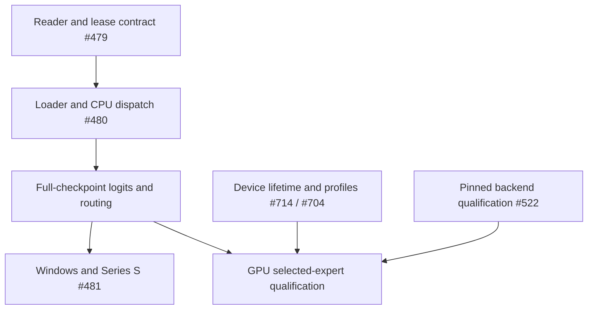

# xLlama engineering consolidation · 28 November 2026

The Developer Mode release is tied to source `ee6a718d` and MSIX `1.11.0.2203`. The release's Series S receipt covers that binary. At the inventory cutoff, `main` was 27 commits ahead. Subsequent main commits `1b55ec21` and `490a3a2f` integrated the Granite cold-continuation comparison (#713) and the isolated GGUF model-open timer (#708). At the second head main was 29 commits ahead of the release. The next verified head, [827c22af](https://github.com/gianlucamazza/xllama/commit/827c22af2d361a4b6e185e332a50ef9a3c335609), integrated [#712](https://github.com/gianlucamazza/xllama/pull/712) and was 30 commits ahead. The source, package and individual branch identities below make it possible to reproduce a result while this backlog changes. [Release receipt](../../../../bench/results/2026-11-27-v1110-series-s-release/README.md) · [Initial governance snapshot and PR reviews](governance.md) · [Granite merge](https://github.com/gianlucamazza/xllama/pull/713) · [Model-open timer](https://github.com/gianlucamazza/xllama/pull/708)

## Engineering decisions and dependencies

| Priority and component                                       | Evidence and risk                                                                                                                                                                                                                                                                                                 | Dependency and acceptance action                                                                                                                                                                                                                                                                                                                                                                                                                                                                                                                                                     |
| ------------------------------------------------------------ | ----------------------------------------------------------------------------------------------------------------------------------------------------------------------------------------------------------------------------------------------------------------------------------------------------------------- | ------------------------------------------------------------------------------------------------------------------------------------------------------------------------------------------------------------------------------------------------------------------------------------------------------------------------------------------------------------------------------------------------------------------------------------------------------------------------------------------------------------------------------------------------------------------------------------ |
| P0 · Chat, personalization and PNG                           | Interrupted writes can separate a conversation from its index, replace unrelated manifest entries or expose an incomplete image. A failed chat read can also replace the current selection.                                                                                                                       | Qualify the chat/manifest transaction in [#732](https://github.com/gianlucamazza/xllama/pull/732), then the checked image publication in [#736](https://github.com/gianlucamazza/xllama/pull/736). Use old files, failed close, restart and recovery on the installed package.                                                                                                                                                                                                                                                                                                       |
| P0 · SessionHub, compute permit and cancellation             | Admission serializes model use across GUI and LAN. A buffered success or error written to a slow client can retain the permit and mutex after computation. Streaming has different cancellation and ownership needs.                                                                                              | On the [#733 candidate](https://github.com/gianlucamazza/xllama/pull/733), observe a second request, normal buffered delivery, SSE disconnect and stale-listener denial. Bind results to package and model. [Compute ownership ADR](../../../adr/0008-process-compute-admission.md)                                                                                                                                                                                                                                                                                                  |
| P0 · Storage, USB and model readiness                        | Free space is measured with the live model already on disk. Replacement can allocate a staged file and a copy of the rollback generation. A config-only import and a failed update can affect Ready state.                                                                                                        | Validate the actual copy/rename sequence and preserve a usable old installation after refusal. Use the selected removable folder and its expected inventory. [#734](https://github.com/gianlucamazza/xllama/pull/734) · [#735](https://github.com/gianlucamazza/xllama/pull/735)                                                                                                                                                                                                                                                                                                     |
| P0 · Recurrent state, KV and memory admission                | Attention KV and hybrid recurrent state need different treatment after eviction. #724 rebuilds from surviving tokens. The shipping no-allocation probe accounts for weights, KV/recurrent state, work buffers and UMA limits before load. A single shift is insufficient to qualify repeated conversation shifts. | Verify two or more shifts in the same conversation for each named model, exact-survivor cold comparison, cancellation, working set and time. Preserve CPU/GPU admission and allocation-fallback tests. [#725](https://github.com/gianlucamazza/xllama/issues/725) · [Architecture](../../../architecture.md#session-memory-admission)                                                                                                                                                                                                                                                |
| P0 · D3D12 submission and readback                           | The removed-device sentinel can be mistaken for completion. The probe can also summarize a partial campaign or a non-finite residual as success. The GGML weight-transfer callbacks have no status return.                                                                                                        | [#743](https://github.com/gianlucamazza/xllama/pull/743) checks accepted fences and measurement outcomes. [#714](https://github.com/gianlucamazza/xllama/issues/714) still needs bounded ownership of all submitted buffers after a live queue rejects a marker, transfer and CPU-tail failure propagation, debug-layer and physical recovery evidence.                                                                                                                                                                                                                              |
| P1 · Linux CLI, Windows/UWP, llama.cpp/GGML and ORT/DirectML | The host exercises GGUF through the shared C++17 core. UWP selects GGUF or ORT GenAI at runtime. ORT's shipped DLL bytes can be checked even when an exact source archive is unavailable.                                                                                                                         | [#741](https://github.com/gianlucamazza/xllama/pull/741) is an isolated pin candidate. Preserve per-checkpoint tolerances, both MSVC builds, package identity, device comparison and rollback. Keep [#646](https://github.com/gianlucamazza/xllama/issues/646) and [#85](https://github.com/gianlucamazza/xllama/issues/85) tied to official source and the actual DLLs. [Vendor lifecycle](../../../vendor-lifecycle-plan.md)                                                                                                                                                       |
| P1 · OpenAI/Ollama, discovery, embeddings and tools          | On the release, unimplemented OpenAI generation options can be silently accepted. Ollama has its own translator. Tool calls are proposals for the client. Replay tests cover a recorded embedding exchange. Current-package streaming, cancellation and tool journeys need a live client.                         | [#737](https://github.com/gianlucamazza/xllama/pull/737) validates five typed fields before admission. Test Python and Node clients against the opted-in endpoint. Qualify Gemma thought boundaries under [#671](https://github.com/gianlucamazza/xllama/issues/671) and measure the 8B forced-call budget under [#680](https://github.com/gianlucamazza/xllama/issues/680). [API contract](../../../api-endpoint.md)                                                                                                                                                                |
| P1 · SSD MoE, loader and operator                            | The merged Reader/cache/lease is host-testable. The pre-fix arena could return a pointer misaligned for the native GGML CPU mapper. The operator fixture exercises a bounded GGUF slice in multiple quantizations and thread counts.                                                                              | [#479](https://github.com/gianlucamazza/xllama/issues/479) → [#480](https://github.com/gianlucamazza/xllama/issues/480) → [#481](https://github.com/gianlucamazza/xllama/issues/481). Review [alignment and admission](https://github.com/gianlucamazza/xllama/pull/738), then the [stacked operator comparison](https://github.com/gianlucamazza/xllama/pull/740). Loader interception before allocation, mixed roles, full checkpoint logits/IDs/gates, cancellation/drain, then Windows Reader and Series S qualification. GPU selected experts have a separate dependency chain. |
| P2 · Hardware profiles, D3D12 and CPU AVX2                   | Kernel correctness, submission cost and end-to-end performance differ by checkpoint, batch, context and device. The release's CPU and GPU routes and each historical fork package have distinct identities.                                                                                                       | Freeze a CPU reference and an opt-in profile per [#704](https://github.com/gianlucamazza/xllama/issues/704). Compare memory, transfer/sync, offload depth, prefill/decode and logits under [#421](https://github.com/gianlucamazza/xllama/issues/421) and [#422](https://github.com/gianlucamazza/xllama/issues/422). [Performance opportunity and negative-results matrix](../../../research/gpu-acceleration-report.md)                                                                                                                                                            |
| P3 · Catalogue, sharded GGUF and new architectures           | A loader recognizing an architecture or a token decoding on a host covers only part of the admission ladder. Routed tensor bytes, resident/shared tensors, KV or recurrent state, allocator padding and temporary buffers all contribute to peak memory.                                                          | Review model licence, artifact hash, tensor roles/shards and actual working set before a console campaign. Require quality and teardown before entering the catalogue. [Product matrix](../../../model-matrix.md) · [Sparse model inventory and byte estimates](../../../research/moe-streaming-candidates.md)                                                                                                                                                                                                                                                                       |
| P4 · Distributed, multimodal and training                    | Two HTTP replicas can increase throughput for independent requests. GGML RPC, layer splitting or routed-expert transfer changes fault and memory ownership. Image generation and on-device personalization already compete for compute and storage.                                                               | [#739](https://github.com/gianlucamazza/xllama/pull/739) records two CPU loopback workers transferring 16 bytes and producing the local F32 result on two pins. [#687](https://github.com/gianlucamazza/xllama/issues/687) first requires measured two-device networking/replicas, then per-stage budgets, failure containment and numerical replay. Use existing [distributed gates](../../../research/distributed/gates.md), [training architecture](../../../training-architecture.md) and milestone 7.                                                                           |

## Release readiness and quality evidence

- **VERIFIED · Published assets.** All five public asset digests and four entries in `SHA256SUMS` matched the downloaded bytes. Opening the 21,328,851-byte MSIX verified its ZIP integrity, `GianlucaMazza.xllama` identity, x64 architecture, `CN=xllama-dev` publisher and both patched vendor DLL hashes. GitHub CLI 2.106.0 verified the signed attestation against the source SHA, main ref, expected workflow, subject digest and hosted runner. Both a substituted subject and a substituted ref were rejected. The packaged DirectML DLL also matched the SHA512-verified Microsoft.AI.DirectML 1.15.4 NuGet. [Independent provenance check](../../../releases/v1.11.0.md) The release receipt records Series S console 10/10, LAN 14/14 and D3D12 24/24, plus the outstanding manual GUI half of the Ollama residency check. [Asset listing](https://github.com/gianlucamazza/xllama/releases/tag/v1.11.0.0) · [Publisher receipt](../../../../bench/results/2026-11-27-v1110-series-s-release/receipts/release-validation.json)
- **VERIFIED · Host baseline.** On `e2abab1` with the six overlays on `d8123504`, GCC 14.2 and CMake 3.31.10 built the host CLI and CTest targets. CTest passed 4/4. The mandatory synthetic CPU reference and context-admission smoke passed. The separate model-backed decode-fault executable passed 3 cases / 193 assertions. Python discovery ran 443 tests with 21 skips. The benchmark summary, research package and release metadata checks passed. A second build at `490a3a2f` also passed 4/4 CTest targets, numerical smoke and all 443 Python tests with the same 21 skips. After #712, the same GCC build on 827c22af passed 4/4 CTest targets, the five numerical reference rows, the three-turn and pressure-recovery checks, and Python discovery (443 tests, 21 skips). The comparison fixture's SHA-256 is `ea5812a29a3260b9d489fadb272e1dddedadaf291d5fcf839b944ee440311881`. [Build and test procedure](../../../../AGENTS.md#testing) · [CPU smoke](../../../../scripts/run-cpu-smoke.py)
- **VERIFIED · Clients.** Official `openai-python 3.60.0` and `openai-node 7.65.0` both serialized the recorded requests and decoded the float/base64 embedding responses. The inputs are the published Series S v1.8 receipt. The LAN endpoints still require an opt-in trusted network and bound admission. [SDK replay and live journey](../../../api-endpoint.md#sdk-replay-of-the-embedding-receipts) · [Surfaces and data boundaries](../standards-2026-11-27/security.md)
- **FAILED · Candidate promotion.** A matched Linux experiment on `qwen35-0.8b` compared seven full-vocabulary rows across the two pins. Maximum absolute logit error 0.604359 exceeded 0.5. Normalized MSE 0.00144747 exceeded 0.001. Three matching greedy tokens do not satisfy these thresholds. Swapping only the upstream CPU softplus expression reproduced every one of the other pin’s 1,738,240 logits in both directions. A 65-decimal-digit scalar reference placed the candidate within one ULP on all 112 observed inputs. Full-checkpoint reference distributions and a paired quality evaluation remain necessary before a pin decision. [#741](https://github.com/gianlucamazza/xllama/pull/741) · [#522](https://github.com/gianlucamazza/xllama/issues/522)
- **BLOCKED / NOT_RUN · Physical acceptance.** This run had no attached Xbox, deployment credentials or Windows debug-layer GPU. CI-produced Windows packages, Linux evidence and historical Series S/Series X receipts have distinct gates. Acquiring a named package, exercising suspend/resume, cancellation, device removal, storage pressure and a subsequent request on that package completes the relevant device row. [Platform constraints](../../../uwp-constraints.md) · [Console runbook](../../../console-validation-runbook.md) · [Release policy](../../../release-readiness.md)

The governance ledger records the starting cut. The linked PRs retain subsequent review and CI history. The fork audit enumerates all branch refs, including inherited history, orphan CI branches and squash equivalents. Its independent Series X campaign belongs to package `1.7.0.1495`. [Branch-level community review](https://github.com/gianlucamazza/xllama/pull/742)

## Subsequent review and reproduced results

| Work                                                                                                                                                                              | What the candidate establishes                                                                                                                                                                                                                                                                                                                                                                                                                                                                           | Next decision                                                                                                                                                            |
| --------------------------------------------------------------------------------------------------------------------------------------------------------------------------------- | -------------------------------------------------------------------------------------------------------------------------------------------------------------------------------------------------------------------------------------------------------------------------------------------------------------------------------------------------------------------------------------------------------------------------------------------------------------------------------------------------------- | ------------------------------------------------------------------------------------------------------------------------------------------------------------------------ |
| [#732](https://github.com/gianlucamazza/xllama/pull/732), [#746](https://github.com/gianlucamazza/xllama/issues/746) and [#749](https://github.com/gianlucamazza/xllama/pull/749) | A failed read retains the saved conversation, rejected out-of-range index metadata retains its journal, and a read-only directory no longer reports a successful deletion. A rejected first save followed by Clear also preserves the RAM-only conversation and its KV snapshot. The final host suite passed 23 cases and 208 assertions, including recovery with both journals present.                                                                                                                 | Verify mixed-success deletion and UI/KV state on the installed revision.                                                                                                 |
| [#734](https://github.com/gianlucamazza/xllama/pull/734), [#735](https://github.com/gianlucamazza/xllama/pull/735) and [#736](https://github.com/gianlucamazza/xllama/pull/736)   | The installed Ready marker survives storage refusal. The space estimator matched 10,000 ordered plans and 64 filesystem fixtures for logical file bytes. The USB candidate keeps the selected source folder. A real host short write preserved the previous complete PNG.                                                                                                                                                                                                                                | Run the disk-pressure update, physical removable-media import and GUI/LAN image tests independently on their package revisions.                                          |
| [#733](https://github.com/gianlucamazza/xllama/pull/733) and [#745](https://github.com/gianlucamazza/xllama/pull/745)                                                             | A rejected chat releases its resources before sending HTTP 503. For embeddings the candidate releases ownership before delivery in 15 tested combinations spanning three routes and five outcomes.                                                                                                                                                                                                                                                                                                       | Observe admission and socket delivery independently for buffered, slow and disconnected live clients.                                                                    |
| [#737](https://github.com/gianlucamazza/xllama/pull/737) and [#747](https://github.com/gianlucamazza/xllama/pull/747)                                                             | The first rejects unsupported generation fields and reasoning-budget aliases. The second tests E2B's real template and per-model thinking markers. On the real E2B checkpoint, generation limits of one, two and three tokens exposed zero marker bytes to users. At 48 tokens, enabling and disabling thought output correctly routed the same 154 bytes into the reasoning and visible fields respectively. Linux CTest passed 4/4 and a client compiled against the prior SDK headers linked and ran. | Verify exact terminal framing, token accounting and discovery on the same package and checkpoint. The #680 forced-call budget is still unimplemented.                    |
| [#748](https://github.com/gianlucamazza/xllama/pull/748)                                                                                                                          | On Linux, each LFM checkpoint passed 30/30 assertions covering two successive shifts with snapshots enabled and disabled. The Granite Q3 control passed 54/54, preserving the same 42 tokens and four-token cold continuation.                                                                                                                                                                                                                                                                           | Collect package-bound Series S traces for both LFM models, timings, working set and cancellation.                                                                        |
| [#707](https://github.com/gianlucamazza/xllama/pull/707) and [#715](https://github.com/gianlucamazza/xllama/pull/715)                                                             | Zero GPU submissions cannot qualify an offload comparison. Replayed 120 preregistered and 36 exploratory pairs. The LAN latency probe rejects an incomplete Content-Length body after an SSE terminal marker.                                                                                                                                                                                                                                                                                            | Attribute each run to actual device, route and complete transport. Preserve the earlier negative cells.                                                                  |
| [#738](https://github.com/gianlucamazza/xllama/pull/738) and [#740](https://github.com/gianlucamazza/xllama/pull/740)                                                             | Linux GCC ThreadSanitizer passed the 12-case cache suite. The real GGUF/operator fixture matched all 144 selected outputs against its resident reference and distinguished the wrong expert in every comparison.                                                                                                                                                                                                                                                                                         | Owner review on the #479 provider contract precedes loader-time native entry, complete checkpoint parity and physical acceptance.                                        |
| [#741](https://github.com/gianlucamazza/xllama/pull/741)                                                                                                                          | All 16 current catalogue GGUFs were exercised on Linux. Thirteen of 14 decoders matched byte for byte on the tested prompt rows. Both embedding contracts passed. The Qwen3.5 disagreement reproduced in independent processes and with microbatch one.                                                                                                                                                                                                                                                  | The reciprocal softplus experiment identifies the operation responsible. A full-model reference, paired quality evaluation and Series S qualification precede promotion. |

The GitHub dependency-graph SPDX export describes 31 packages and 31 relationships at the observed `main`. It contains no file-level MSIX inventory. The original export, schema validation, CodeQL and sanitizer scope, and the public visibility limits of security settings are recorded in the [quality assessment](../standards-2026-11-27/quality.md). [#750](https://github.com/gianlucamazza/xllama/pull/750) adds the package-level SPDX 2.3 inventory. Independent generation from the released MSIX produced the same 35,662-byte document, with 29 files, four packages and 36 relationships. Its SHA-256 is `ff8593b16f5d11b546e744c549b68156deeb1c7d92f00a4f402ca64afb4ccd5b`. A protected main build after review is required for the first SPDX attestation. The original release already has its own verified SLSA provenance.

For [#714](https://github.com/gianlucamazza/xllama/issues/714), an independent host replay of the exact [#743](https://github.com/gianlucamazza/xllama/pull/743) backend methods exercised a queue that accepted work and rejected the completion marker. With two simulated transfers, it observed one premature allocator reset and eight stale readback bytes. Safe recovery requires ownership of all submitted buffers and an observable error through synchronous GGML copies and the CPU tail. The Windows debug-layer and Series S device-recovery checks remain open.

## Acceptance dependencies

The host operator fixture and Windows CI can run while the provider contract is under review. Each arrow describes a prerequisite for accepting the downstream feature. The distributed experiments retain their separate [two-device sequence](../../../research/distributed/gates.md). The [architecture assessment](../standards-2026-11-27/architecture.md), [engineering roadmap with rollback conditions](../standards-2026-11-27/roadmap.md), [dependency and patch inventory](../standards-2026-11-27/dependencies.md), [API and LAN boundaries](../standards-2026-11-27/security.md) and [adopted and proposed decisions](../../../adr/) describe the responsible components.

## Evidence and decision ownership

Record source SHA, dependency pin, exact package and checkpoint hash, hardware identity and parameters before collecting data. Split model-open, first-token, prefill, decode and end-to-end timing and include sample counts for percentile claims, memory, errors, cancellation and quality. For SSD work also distinguish logical from physical I/O and record cache size/hits. Unknown counters stay unavailable. Use **MEASURED** for a direct observation, **VERIFIED** for a checked reference or invariant, **ESTIMATED** for modelled quantities, **PROPOSED** for a candidate, **NOT_RUN** for an unexecuted check, **BLOCKED** for an unmet prerequisite and **FAILED** for an executed check missing its criterion. [Benchmark contract](../../../../bench/README.md) · [MoE comparison methodology](../../../research/moe-upstream-readiness.md) · [Distributed protocol](../../../research/distributed/protocol.md)

The project already owns separate release and research milestones. The dated [governance matrix](governance.md) records these and the open acceptance criterion for each issue. Existing decisions cover admission, HTTP framing, numerical checks and experimental coordination. Proposals remain subject to maintainer review. [ADR directory](../../../adr/) · [Engineering roadmap](../../../../ROADMAP.md)
