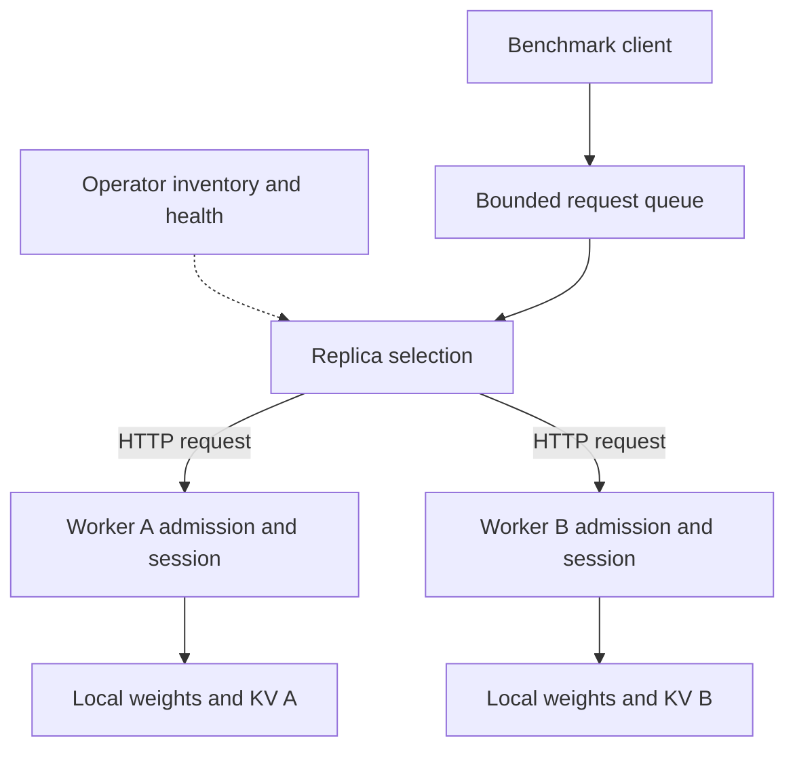
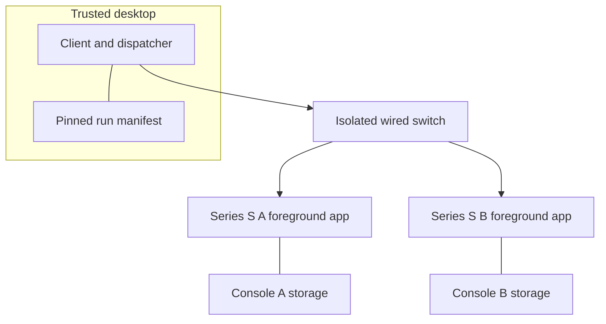
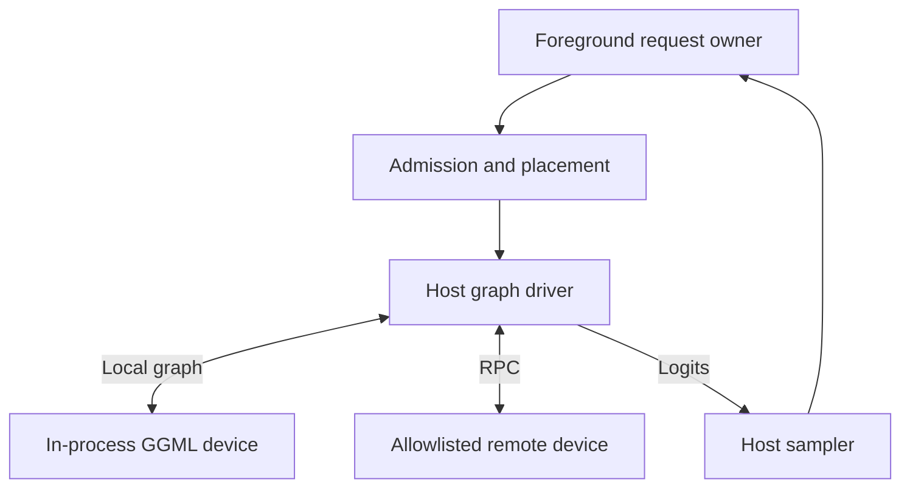
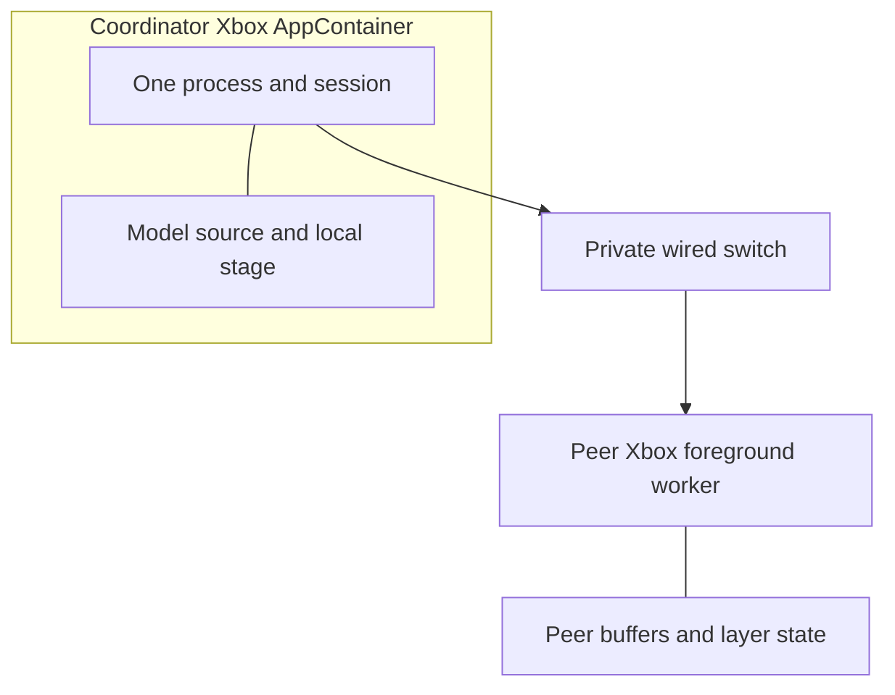
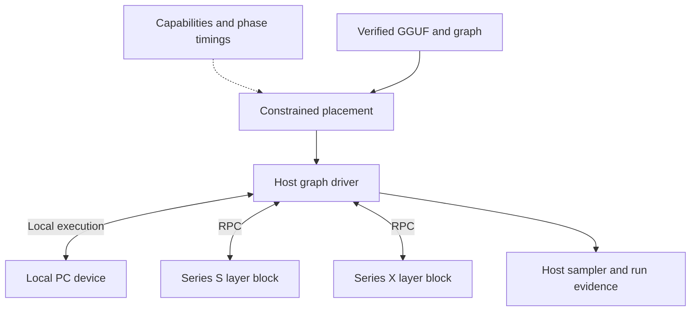
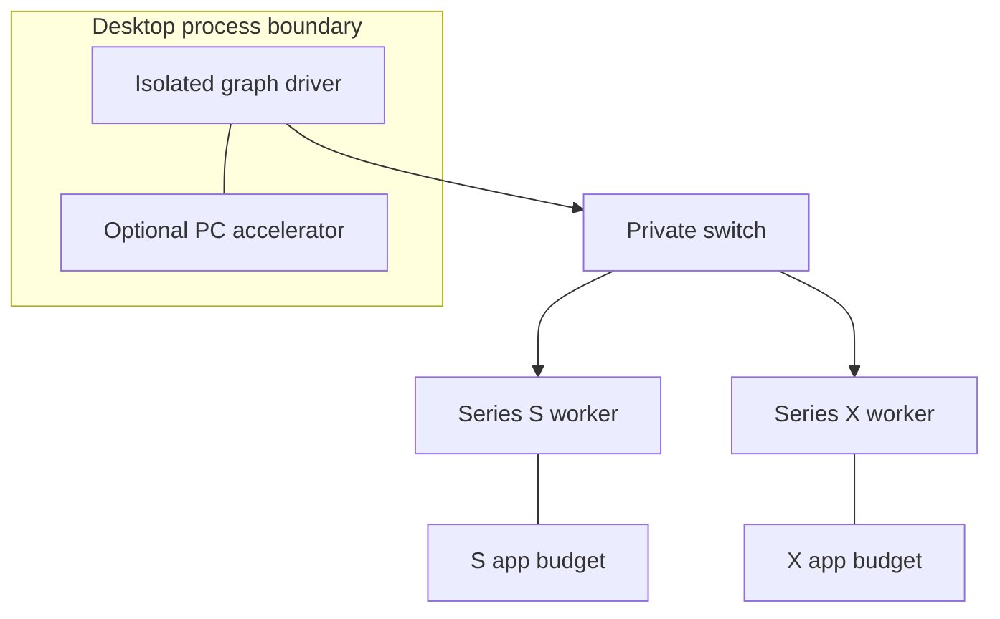

# Architecture candidates and placement

**Proposed.** Start with configuration A and two independent replicas. It tests whether an operator with two consoles can serve more simultaneous requests at an acceptable tail latency. Only a separately approved DC-3/DC-4 could test whether splitting one GGUF increases capacity. In both cases a user can still start a single xllama console normally.

## Boundaries already in the product

**Verified at xllama `bc53c3d`.** The opt-in, foreground LAN server exposes unauthenticated HTTP on the private network. `GET /health` describes the build and API contract. `GET /v1/models` describes locally servable models. A chat request supplies the full prompt. Exact-prefix KV reuse is an optimization local to the resident GGUF session. The process has one resident `SessionHub` shared with the UI, one compute permit and a bounded listener. A busy worker can return 503. Inspect the error body because 503 can also mean out of memory. Session memory admission checks host allocations and device budgets separately, including the overlap on a UMA GPU. The existing discovery document does not attest model bytes, physical accelerator, current memory headroom or distributed operators. [LAN contract](https://github.com/gianlucamazza/xllama/blob/bc53c3d6dfb202db6a14d780643db6f9f262f8ea/docs/api-endpoint.md) · [Session ownership and memory admission](https://github.com/gianlucamazza/xllama/blob/bc53c3d6dfb202db6a14d780643db6f9f262f8ea/docs/architecture.md) · [Session spec ADR](https://github.com/gianlucamazza/xllama/blob/bc53c3d6dfb202db6a14d780643db6f9f262f8ea/docs/adr/0007-session-spec.md)

**Verified at llama.cpp `d812350`.** The GGML RPC client in the process running llama.cpp drives remote device buffers and graph splits. For a copy between distinct RPC servers, the pinned RPC buffer declines the local copy. The generic backend then reads into a host buffer, writes to the destination and frees that buffer. The host owns transient copies and consumes both network legs. A direct peer transfer, zero-copy, a physical cable chain or a distributed shared address space would each require separate evidence. [RPC buffer copy](https://github.com/ggml-org/llama.cpp/blob/d81235049384534c167caea52b85a694f6103d14/ggml/src/ggml-rpc/ggml-rpc.cpp) · [GGML copy fallback](https://github.com/ggml-org/llama.cpp/blob/d81235049384534c167caea52b85a694f6103d14/ggml/src/ggml-backend.cpp)

## A. External coordinator

**Proposed, first experiment.** One Linux or Windows desktop hosts the request dispatcher. A benchmark client with a static worker list suffices for DC-2. For a single client-facing API on the private LAN, an existing reverse proxy would need to pass the same SSE, admission and cancellation checks. Two foreground Xboxes serve independent copies of the same model through their existing API. A client sees one service. Each successful turn executes on one console. A future, separately qualified GGML driver would run as an isolated desktop process and require an RPC-capable experiment on each worker. These are different experiments with different traffic and failure semantics.

**Components**

**Deployment**

**Control and data.** The operator lists endpoints explicitly. The dispatcher checks contract, locally installed model IDs, required capabilities and separately verified package/model hashes before admission. Send one full request to the least-loaded eligible replica, stream its response back, and give an existing conversation preference on its warm worker. Bound queue length, request body, response buffer and queue deadline. Keep one dispatched generation per console. Preserve SSE terminal and error records and propagate client cancellation by closing the worker stream. No continuous batching contract exists for multiple concurrent chat requests on one console. Group _independent_ requests across workers and record client-visible queue delay. For an overloaded pool, report overload. For memory refusal, change the admission decision rather than repeatedly retrying the same shape.

**Session and failure.** A replica owns its complete GGUF, tokenizer, scratch and KV. The host owns routing and any conversation supplied by the client. On lost affinity, a new healthy replica must prefill the full prompt. A disconnect after partial delivery ends that response with an error. Do not silently duplicate visible tokens or resubmit an ambiguous request. Failure of the dispatcher takes the front door down while independently operated consoles remain usable. Restart with a fresh inventory check. For the future RPC alternative the host instead owns one model/graph, sampler and worker lifetimes; losing a shard invalidates that whole context.

## B. Xbox-native coordinator

**Proposed, deferred.** One Xbox would host the foreground coordinator and contribute local compute. Compare the same model placement against A first. The candidate must justify its additional memory and lifecycle cost with device evidence. A DLL, secondary service or local loopback listener is not part of this design.

**Components**

**Deployment**

**Control and data.** The operator would select peer addresses locally. All coordinator and worker roles in this diagram are proposed. Validate build and graph compatibility, available app/device headroom and split before assigning tensors. Execute the coordinator's own stage in-process. The peer holds designated buffers for the lifetime of the generation. The coordinator must budget tokenizer, graph metadata, input/output tensors, sampled logits, local KV, network staging plus the GUI and OS margin. Measure peak startup residency and storage required by the coordinator's source GGUF as well as steady state. Earlier layers, logits or fallback operations can execute on the host even if most weights are remote.

**Session and failure.** One admission owner must cover both local and remote work and release all resources on teardown. No console inherits authority when the coordinator suspends. Expire the run, drop stale handles and require a fresh cold start after resume. The pinned RPC client has fatal error paths on disconnect. Until a recoverable path works under AppContainer lifecycle and protects the main app, keep B at no-go for a production process. The private switch and both apps sit inside the experiment's trust boundary. Even if a desktop terminates TLS for clients, that does not secure the Xbox leg. Microsoft documents TLS client support and the lack of server-side TLS negotiation on an accepted UWP `StreamSocket`. [UWP networking](https://learn.microsoft.com/en-us/windows/uwp/networking/networking-basics#creating-secure-socket-connections) · [Pinned RPC source](https://github.com/ggml-org/llama.cpp/blob/d81235049384534c167caea52b85a694f6103d14/ggml/src/ggml-rpc/ggml-rpc.cpp)

## C. Heterogeneous cluster

**Proposed, after homogeneous parity.** A desktop coordinates Series S, Series X and a PC compute device. Fix the role of the PC in each run. Test the external PC with compute disabled, then enable its local device as a separate treatment. Calibrate the PC alone with the identical target. A fast PC doing most of the graph can otherwise make a weak Xbox contribution appear useful.

**Components**

**Deployment**

**Control and data.** Start with a manually approved inventory. Record actual CPU/backend identity, supported operators and dtypes from fixtures, GGML protocol and package build, context, per-node budgets, per-stage timings, and measured duplex links. The RPC device proxy's generic capabilities are insufficient for scheduling. Reject incompatible combinations. For replicas, route to a matching node using its measured response time. For a split, fix contiguous layer owners for the whole session. Minimize serial stage time plus transfers for one sequence, or the slowest stage for a saturated pipeline, subject to each local budget. Then measure both prefill and decode. A single partition can favor one phase. Freeze placement for the run and record PC host relay traffic separately.

**Session and failure.** The coordinator owns the canonical GGUF, prompt and sampler for a split. Each device owns its shard and its own layer state. Workers may use different compute backends only after matched tensor/logit and router evidence. A failed shard terminates the session; re-planning is a new run with full prefill. A failed _replica_ removes only that endpoint from future admission. Membership changes never silently change a running graph, precision or model. Use one trusted segment for admitted workers and restrict client ingress to the operator host.

### Worked heterogeneous placement

**Estimated illustration, independent of SKU performance.** Suppose the fixture has 32 equal layers. After charging fixed overhead, assume three candidate nodes S, X and PC can hold 8, 12 and 20 layers, with per-layer decode times of 1.8, 1.1 and 0.6 ms respectively. Assume 0.5 ms per serialized activation leg, a sampler on the PC and no overlap for a single sequence. The comparison below covers layer work and inter-stage traffic only. Measure input/output, KV, copies and synchronization for each placement before applying it to a real model.

| Contiguous assignment | Layer time | Activation routing            | Partial single-token time | Slowest compute stage |
| --------------------- | ---------: | ----------------------------- | ------------------------: | --------------------: |
| X 12 → PC 20          |    25.2 ms | X→PC, one leg                 |                   25.7 ms |               13.2 ms |
| S 6 → X 10 → PC 16    |    31.4 ms | S→PC→X, then X→PC, three legs |                   32.9 ms |               11.0 ms |

Here the added worker slows a single sequence while lowering the compute bottleneck for enough independent work. Whether saturated throughput improves depends on the shared network, scheduler overlap, admission and KV capacity. Replace all four input assumptions with per-device observations for each phase.

## What crosses the link

| Strategy                      | Ownership and communication                                                                                                                                                                                                                                  | Consequence to test                                                                                                                                                                                                                                                                                                                        |
| ----------------------------- | ------------------------------------------------------------------------------------------------------------------------------------------------------------------------------------------------------------------------------------------------------------ | ------------------------------------------------------------------------------------------------------------------------------------------------------------------------------------------------------------------------------------------------------------------------------------------------------------------------------------------ |
| Request replicas              | A full model per worker. Prompts and token streams cross the link once per request. KV stays with the replica.                                                                                                                                               | In the absence of a shared bottleneck, the service ceiling is the sum of independent worker rates. Single-request decode latency still depends on its one worker. Queueing can improve at a fixed offered load.                                                                                                                            |
| Contiguous layer split        | Weights and attention KV or recurrent state remain with each layer's owner when placement permits. Inputs, intermediate activations, residual paths, logits and graph control may cross device boundaries. Verify actual buffer placement and CPU fallbacks. | A single sequence traverses the critical path serially for each token. With enough independent, admissible microbatches, stages may overlap. Charge fill, drain, KV per sequence, staging, synchronization and the slowest stage.                                                                                                          |
| Tensor/row split              | Each selected operation is partitioned. A typical dense tensor-parallel schedule requires collective results in attention and FFN repeatedly within each layer. A backend's row split and its collective tensor mode have different layouts.                 | Compare the saved compute with the collective's startup plus byte transfer at every synchronization. A 32-layer graph with two serialized collectives per layer and a **hypothetical** 1 ms/collective already spends 64 ms/token before compute. No-go as the initial Gigabit experiment. [Megatron-LM](https://arxiv.org/abs/1909.08053) |
| Expert split                  | The graph computes its exact selected expert IDs and weights. Dispatch activations to the devices holding those experts and combine results before the subsequent dependent layer.                                                                           | The slowest selected expert and all return paths lie on the token's critical path. Track distinct destinations, fan-in, router fanout, hot experts and imbalance by layer. [Tutel](https://proceedings.mlsys.org/paper_files/paper/2023/hash/5616d34cf8ff73942cfd5aa922842556-Abstract-mlsys2023.html)                                     |
| Distributed SSD-backed MoE    | The layer owner keeps the router, shared computation and its layer state. Each expert owner can acquire exact tensors through its local bounded reader/cache. Layers can additionally be split contiguously.                                                 | Every miss can add storage latency on top of network dispatch. The worst busy expert, constrained cache and storage tail can dominate P99. DC-8 depends on independent DC-7, local SSD parity and matched console acceptance.                                                                                                              |
| Context partition / remote KV | A context split exchanges KV blocks or partial attention reductions as required by its attention algorithm. Disaggregated prefill/decode moves the prompt's KV between pools and must agree on layout, positions and dtype.                                  | Long-context capacity and phase utilization are independent experiments. Keep KV local to layers for DC-4. Compare a proposed migration's total bytes against full-prompt recomputation. [Ring Attention](https://arxiv.org/abs/2310.01889) · [DistServe](https://www.usenix.org/conference/osdi24/presentation/zhong-yinmin)              |

**Estimated lower bound for a layer cut.** If an actual tensor has `T` token rows, hidden width `H` and `b` bytes per element, one contiguous transfer carries `T × H × b` payload bytes. With `H=4096`, `b=2` and two remote-only stages, one decoded row accounts for 8 KiB on each of the two relay legs. A 512-token prefill accounts for 4 MiB on each leg. Float32 doubles these figures. These exclude any input, output, metadata, extra cuts, retransmission and GPU staging. Divide bytes by measured directional bytes/s and add critical-path startup and copies. Count bytes per directed link and per host interface; a full-duplex path does not turn a dependent GET then SET into simultaneous work. Balanced, equal-duration stages with `m` independent forward microbatches on `s` stages have an ideal fill/drain utilization of `m / (m + s - 1)`. Pin eligibility, event support, actual overlap and the process admission rule determine what can be achieved. [Upstream pipeline guard](https://github.com/ggml-org/llama.cpp/blob/d81235049384534c167caea52b85a694f6103d14/src/llama-context.cpp) · [GPipe](https://papers.nips.cc/paper/2019/file/093f65e080a295f8076b1c5722a46aa2-Paper.pdf)

### Preserving a routed model

**Proposed for DC-7/DC-8.** Identify each expert by checkpoint digest, layer, expert index, tensor role and quantization. Record exactly which layers are routed, their router score operation, group constraints, top-k/tie behavior, selected weights, normalization, shared experts, and the reference combine order. Placement and hot-expert replication may change _where_ an already-selected expert runs. Replacement by a cached neighbor, dropped expert, capacity-based rerouting or lower-precision substitute would invalidate the parity experiment.

For one routed token at one layer, let `d` be the number of distinct remote owners serving `r` selected remote experts. With identical full-width input vectors at a local dispatcher, send at least `d × H × b_in` if each destination can reuse one input. Returning each expert's vector for ordered combination adds `r × H × b_out`. A remote partial sum could reduce the latter to `d × H × b_out` **only** with approved arithmetic-equivalence/tolerance evidence. With one send per expert, outbound traffic uses `r` too. Apply the real topology hop factor, per-message framing and synchronization. Derive `d`, `r`, per-expert queue depth and cache hit-bytes from router traces. A request-count hit rate cannot predict bytes for differently sized experts.

Charge replicas against every node's own budget. Freeze placement per run. On a local miss, lease the exact expert until its computation completes, bound pinned and staged bytes and apply backpressure when all slots are live. Measure cold and warm reads, sustained device throughput, tail latency and bytes per generated token. Restart safely on failed I/O or disconnect. Validate selected IDs, weights, intermediate expert outputs and final logits before timing. Retain the accepted single-node sequence [#479](https://github.com/gianlucamazza/xllama/issues/479) → [#480](https://github.com/gianlucamazza/xllama/issues/480) → [#481](https://github.com/gianlucamazza/xllama/issues/481) and its independent GPU gate. [MoE readiness](https://github.com/gianlucamazza/xllama/blob/bc53c3d6dfb202db6a14d780643db6f9f262f8ea/docs/research/moe-upstream-readiness.md) · [OOC-6 origin](https://github.com/gianlucamazza/xllama/issues/536)

## Logical and physical topology

| Candidate        | Logical communication                                            | Disposition                                                                                                                                            |
| ---------------- | ---------------------------------------------------------------- | ------------------------------------------------------------------------------------------------------------------------------------------------------ |
| Switched star    | Coordinator selects replicas or drives RPC endpoints.            | **Proposed** for A. All nodes attach to a wired switch. Measure the coordinator port under simultaneous fan-in/fan-out.                                |
| Logical pipeline | Layer stages form an execution order over the switched fabric.   | **Proposed** for DC-4. Any direct worker-to-worker transport is **Unverified**. Measure coordinator relay and extra graph cuts.                        |
| Logical ring     | Neighbors exchange shards or reduce partials on a switch.        | **Unverified** on Xbox. Synchronization cost rises with rank count. No premise of a second console NIC or pass-through.                                |
| Mesh             | Multiple direct peer flows or expert destinations on the switch. | **Rejected** for the initial prototype. It widens admission and trust obligations without evidence of a need; revisit only with measured DC-7 traffic. |

**Two-node decision.** Use the same two workers, pinned fixtures and private wired switch for A. First compare each worker alone and then two replicas under the same independent requests. For a separately approved one-model test, lock the external host to its declared role, use a small CPU-reference GGUF with a two-block split, prove both workers execute real operations, and preserve cold/warm startup, numerical, per-link, memory and failure receipts. A model known to fit the reference makes independently verifying outputs possible. Only after that result should a capacity-only case test a model that exceeds one worker's measured budget.
