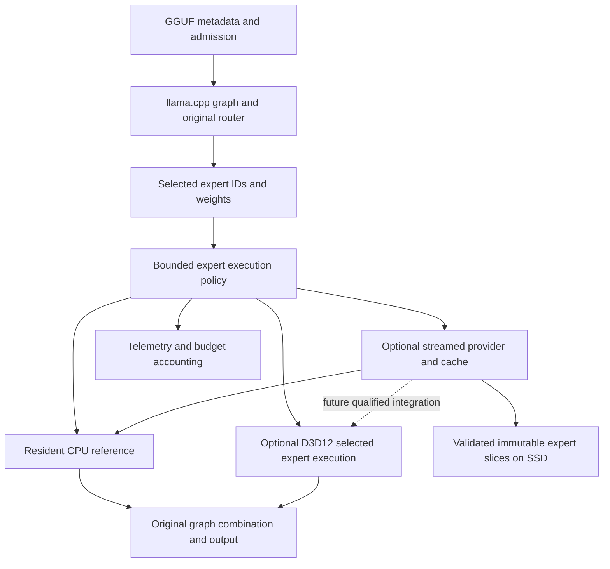
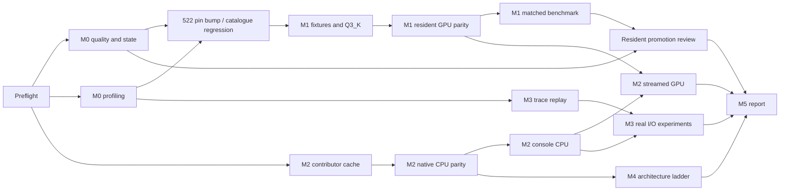

# xLlama — Evidence-Gated MoE Engineering Program

**Status:** Accepted for M0 only (2026-11-24)  
**Date:** 2026-11-24  
**Repository:** [gianlucamazza/xllama](https://github.com/gianlucamazza/xllama)  
**Primary target:** Xbox Series S, Developer Mode, one resident session per process  
**Secondary target:** Xbox Series X — this program's new tests run on Series S only. Any Series X figure is attributed exactly as "Series X figures measured by Joshua Henne (Eidon Labs Inc.), xllama contributor"; never "validated" or "certified".  
**Baseline:** `main` observed at `5fc349a431df88fac571d44abbf54dac8ebf2894` on 2026-11-24; llama.cpp pin `d81235049384534c167caea52b85a694f6103d14`  
**Proposed repository location:** `docs/superpowers/plans/2026-11-24-moe-engineering-program.md`  
**Scope:** roadmap, architecture decisions, execution backlog, validation and release policy. This document does not authorize a merge, publication, hardware run, contributor assignment or change of product defaults. M0 (E0–E2) is the only accepted execution slice.

> **Core decision:** first prove that resident MoE offers a useful product advantage on the existing hardware; then independently qualify selected-expert GPU execution and the SSD research path. Preserve model routing semantics, memory safety, numerical correctness, and reproducibility throughout.

## 1. Executive summary

xLlama has an opportunity to make Mixture-of-Experts (MoE) inference practical on constrained unified-memory devices. A successful program is not measured by the largest checkpoint that emits a token, but by the set of models that deliver useful quality, acceptable interactive latency and reliable lifecycle behavior within a measured memory budget.

The immediate opportunity is Granite-4.0-H-Tiny (approximately 7B total / 1B active). The merged [#527](https://github.com/gianlucamazza/xllama/pull/527) reports a CPU-only decode result of 21.73 tok/s versus 14.06 tok/s for Llama 3.2 3B (approximately +54.6%), with the preliminary Series S speed, TTFT and memory gate passing. Equal-quality comparison is not yet measured. The result is not a GPU speedup or catalogue admission.

In parallel, [#479](https://github.com/gianlucamazza/xllama/issues/479)–[#481](https://github.com/gianlucamazza/xllama/issues/481) track the existing contributor-led SSD expert streaming work. A 24B fork CPU run has been independently reproduced, but full native resident-versus-streamed numerical parity and upstream activation remain separate acceptance stages.

### Goals

1. Qualify Granite as a resident product candidate or record an explicit rejection.
2. Introduce an optional, bounded D3D12 selected-expert path, starting with a minimal numerically verified `MUL_MAT_ID` implementation.
3. Evaluate Q3_K support independently from expert selection and establish whether it improves the actual target graph.
4. Complete the existing SSD provider, native loader, CPU parity and console acceptance sequence without duplicating contributor work.
5. Use trace-driven experiments to establish the value of cache, prefetch, batching and placement policies before increasing runtime complexity.
6. Extend architecture support through explicit capability descriptors and fixtures, with hybrid recurrent state handled correctly.
7. Produce reproducible, attributable results and upstreamable contributions where appropriate.

### Non-goals

- Replacing llama.cpp routing, retraining routers, reducing top-k, substituting experts, or skipping selected experts.
- Making SSD MoE a shipped product tier during this program without a separate product decision.
- Automatically bumping the llama.cpp pin, changing product defaults, or redesigning the whole D3D12 backend. [#522](https://github.com/gianlucamazza/xllama/issues/522) is a separately approved, explicit pin-bump program after 1.8.1 (full-catalogue regression first); it is not an automatic bump.
- Promising a particular token rate, model size, thermal improvement, or Series X result before measurement.
- Treating CPU/GPU shared physical memory as independent additive capacities.
- Parallel reimplementation of a contributor's pending cache extraction; preserve attribution and agree ownership.
- Adding a new public API, GUI control, or catalogue entry before qualification.

## 2. Baseline and evidence inventory

| Area               | Observed state                                                                                                                                                                                                      | Evidence / owner issue                                                                                                                                                         |
| ------------------ | ------------------------------------------------------------------------------------------------------------------------------------------------------------------------------------------------------------------- | ------------------------------------------------------------------------------------------------------------------------------------------------------------------------------ |
| Resident MoE       | CPU path exists; earlier LFM2.5-8B-A1B H2 hypothesis failed product gate                                                                                                                                            | [#273](https://github.com/gianlucamazza/xllama/issues/273)                                                                                                                     |
| Granite Hybrid     | Host smoke, hybrid snapshot smoke and three console T3 runs reported; quality pending                                                                                                                               | [#525](https://github.com/gianlucamazza/xllama/issues/525), [#527](https://github.com/gianlucamazza/xllama/pull/527)                                                           |
| D3D12              | Dense `MUL_MAT` for Q4_0, Q4_K, Q6_K, plus optional Q5_K/IQ4_XS/IQ3_XXS; `GET_ROWS` Q6_K and opt-in bias ADD/RoPE                                                                                                   | [#513](https://github.com/gianlucamazza/xllama/pull/513), [#530](https://github.com/gianlucamazza/xllama/pull/530)                                                             |
| Routed experts     | No upstream D3D12 `MUL_MAT_ID`; Q3_K and recurrent SSM/DeltaNet GPU ops absent                                                                                                                                      | [#524](https://github.com/gianlucamazza/xllama/issues/524)                                                                                                                     |
| Hybrid snapshots   | Existing implementation; Granite host test passes, recurrent context-shift concern unresolved                                                                                                                       | [#512](https://github.com/gianlucamazza/xllama/pull/512), #527                                                                                                                 |
| SSD provider/cache | Proposed extraction; contributor API/ownership agreement and review outstanding                                                                                                                                     | #479, [Discussion #435](https://github.com/gianlucamazza/xllama/discussions/435)                                                                                               |
| SSD native parity  | 8B resident reference and verifier merged; streamed captures pending; separate 24B reference outstanding                                                                                                            | [#508](https://github.com/gianlucamazza/xllama/pull/508), [#509](https://github.com/gianlucamazza/xllama/pull/509), [#480](https://github.com/gianlucamazza/xllama/issues/480) |
| SSD console        | Fork 24B CPU EOS/EOT and teardown reproduced; 8B trace-limited records partial                                                                                                                                      | [#487](https://github.com/gianlucamazza/xllama/pull/487), [#488](https://github.com/gianlucamazza/xllama/pull/488), #481                                                       |
| GPU profiling      | Per-dispatch and per-layer attribution available; Series X and other questions open                                                                                                                                 | [#421](https://github.com/gianlucamazza/xllama/issues/421)                                                                                                                     |
| Series X           | This program's new tests run on Series S only. Existing Series X figures measured by Joshua Henne (Eidon Labs Inc.), xllama contributor; never "validated" or "certified". Matched project matrix remains #422/#374 | [#422](https://github.com/gianlucamazza/xllama/issues/422), [#374](https://github.com/gianlucamazza/xllama/issues/374)                                                         |
| llama.cpp pin bump | Owner-approved to happen after 1.8.1; first a full-catalogue regression PR. Changes the measurement baseline, so it is sequenced before any M1 GPU work. Not an automatic pin bump                                  | [#522](https://github.com/gianlucamazza/xllama/issues/522)                                                                                                                     |
| Release baseline   | v1.8.1.0 is published ([release](https://github.com/gianlucamazza/xllama/releases/tag/v1.8.1.0), package 1.8.1.1764)                                                                                                | [#529](https://github.com/gianlucamazza/xllama/pull/529), #530                                                                                                                 |

Known issue: #527 notes `can_shift=1` on the Mamba2 hybrid. This is a hypothesis of incorrect recurrent-state shifting, not a confirmed bug. Investigate before qualifying multi-turn/context-overflow behavior.

### Baseline preflight (mandatory)

- Read current `AGENTS.md`, architecture, model-selection, model-matrix, profiling and release docs; re-read #273, #395, #421, #422, #479–#481, #524–#526 and merged PRs cited above.
- Record actual `main` and submodule pins, source hashes, open PRs, existing task owners, exact UWP/MSVC package and device designation. Resolve any drift in this plan before implementation.
- Review relevant existing work in [vetax-by](https://github.com/vetax-by/xllama/tree/codex/ua50-ssd-moe), [christopherbearman](https://github.com/christopherbearman/xllama) and upstream llama.cpp. **Clean-room only:** forks are read for ideas and provenance; fork code is never run or copied. Contributor work arrives only via their own PRs. Verify license, provenance, APIs, backend assumptions and applicable upstream changes at exact revisions. Do not assume that an upstream GPU expert cache applies to xLlama's pinned D3D12 backend.
- Do not introduce a new planning umbrella if #524 can be extended. Put GPU work under #421/#481 and cache/loader work under #479/#480. Coordinate with [#395](https://github.com/gianlucamazza/xllama/issues/395).

## 3. Target architecture and invariants



This is a logical decomposition, not a commitment to a new scheduler class or a new layer above llama.cpp. Implement at existing graph/backend/provider boundaries wherever possible.

### 3.1 Numerical and routing contract

- Respect the original selected expert IDs, gating weights, shared expert computation, biases, tensor layouts, and accumulation semantics. Any permitted numerical difference is governed by a frozen comparator declaration.
- Isolate operator parity, graph parity, route agreement and product quality. Operator selftests alone do not prove model correctness.
- For cache and placement experiments use exact routing traces; speculative prefetch may load additional data but must not affect output or chosen expert IDs.
- Unsupported GPU operations/types/shapes are rejected at capability/placement time and use the existing legal CPU path. After partial GPU execution or device loss, fail safely unless full replay with valid state is proven. Never silently switch to full resident loading after a streamed admission/read failure.
- Preserve feature-off behavior and catalogue defaults.

### 3.2 Memory model

Track byte-accounted budgets for shared/non-routed weights, resident expert weights, expert cache, KV and recurrent state, graph workspace, application overhead, I/O staging, GPU resources, metadata and safety reserve. Count distinct allocations and avoid double-counting aliases; count real duplicated CPU/GPU resources separately.

A proposed admission model:

```text
projected_committed = distinct_resident_allocations
                    + bounded_expert_cache
                    + bounded_staging_and_inflight
                    + KV_and_recurrent_state
                    + graph_workspace_and_metadata
                    + app_overhead_and_reserve
```

Admission is conservative, checked for integer overflow and updated on pressure. It is not a substitute for console measurement. Preserve the resident product gate of **peak working set <= 3584 MiB** at the existing product context and test protocol. For streamed research, require an explicitly declared byte budget, actual app quota, safe reserve and lifecycle evidence; do not reinterpret the resident gate as proof of streamed product readiness.

### 3.3 Expert provider contract

Keep #479 as the source of truth: immutable identity (checkpoint identity, tensor/role, expert ID, validated extent/layout), RAII leases, bounded allocation, short-read/error rejection, deterministic eviction, cancellation and drain. The lease survives all CPU workers and, where later supported, the GPU fence. Separate cache hits by request and bytes; physical I/O is only reported when directly observed.

## 4. Proposed architecture decisions (ADR backlog)

These are draft decisions, not accepted ADRs. Use existing ADR numbering and format; do not invent repository IDs before checking current conventions.

| Local ID   | Proposed decision                                                      | Alternatives / rationale                                                                                                                                                               | Approval gate                                              |
| ---------- | ---------------------------------------------------------------------- | -------------------------------------------------------------------------------------------------------------------------------------------------------------------------------------- | ---------------------------------------------------------- |
| ADR-MOE-01 | Two independently gated tracks: resident product and streamed research | Single blended track hides attribution and weakens admission discipline                                                                                                                | Maintainer review; #273/#481 alignment                     |
| ADR-MOE-02 | Original router is authoritative; placement is semantics-preserving    | Approximate routing and expert skipping change model behavior and are out of scope                                                                                                     | Operator + full graph parity contract                      |
| ADR-MOE-03 | Extend backend capability predicates incrementally, opt-in             | Large generic GPU rewrite increases regression risk                                                                                                                                    | #421 evidence and feature-off regression                   |
| ADR-MOE-04 | Byte-budgeted lease-based provider with safe terminal drain            | Slot-only cache or early reclamation risks OOM/use-after-free                                                                                                                          | #479 review and sanitizer evidence                         |
| ADR-MOE-05 | Hybrid state is part of continuation correctness                       | KV-only reasoning is insufficient for recurrent state                                                                                                                                  | Context shift and snapshot tests                           |
| ADR-MOE-06 | Trace-driven policy evaluation before runtime prediction               | Blind LRU replacement may increase bytes and misses; oracle only bounds offline potential                                                                                              | Frozen held-out traces and matched runtime tests           |
| ADR-MOE-07 | Keep pinned llama.cpp; prefer minimal upstreamable changes             | No automatic pin bump. Full pin bump only through the separately approved #522 regression program (after 1.8.1, full-catalogue regression first); selective backport only if justified | Provenance, compatibility, patch drift and full regression |
| ADR-MOE-08 | Promote capabilities, not architecture labels                          | Loading or a smoke test does not prove full support                                                                                                                                    | Model/quant/device/context-specific evidence               |

## 5. Milestones and implementation backlog

Priority definitions: **P0** correctness, baseline or critical dependency; **P1** measurable optimization or existing integration; **P2** research after prerequisites. Priority is not permission to bypass a gate. All tasks below are proposed work; completed baseline PRs are not counted as completed future tasks.

### M0 — Consolidate resident MoE and evidence (P0)

**Exit:** Granite receives an explicit #273 verdict; context-shift behavior is understood and safe; profile gaps and GPU candidate are documented.

| ID   | Deliverable / proposed PR boundary                                 | Depends on | Acceptance                                                                                                                                          |
| ---- | ------------------------------------------------------------------ | ---------- | --------------------------------------------------------------------------------------------------------------------------------------------------- |
| M0.1 | Baseline/evidence map, update #524 and model matrix                | Preflight  | Current code and issue status reconciled; no duplicated work                                                                                        |
| M0.2 | Granite quality campaign using existing H9/product bar             | #525/#527  | Same frozen quality bar as dense peer; all attempts and failures recorded; compare context/template differences                                     |
| M0.3 | Investigate recurrent context shifting and snapshot continuation   | #512/#527  | Cold vs continued/restore comparisons; pure extension, truncation, non-prefix, context boundary, reset; disable unsafe shift capability if required |
| M0.4 | Expert/graph profiling sidecar using existing #421 instrumentation | M0.1       | Counts of selected IDs, op/quant/shape, layer, phase, time and memory; bounded traces, overhead calibration and no default changes                  |
| M0.5 | Resident GPU feasibility note and frozen experiment declaration    | M0.1/M0.4  | Identify actual Granite ops and quant types, allocation/dispatch costs and minimal candidate; choose order of Q3_K vs routed op based on trace      |

**Granite candidate decision:** if quality fails, retain the negative result and do not add it to the catalogue. GPU work may continue on fixtures or a different qualifying candidate; do not tune quality gates after seeing results.

### Pin bump (#522) — after M0, before any M1 GPU work

[#522](https://github.com/gianlucamazza/xllama/issues/522) is owner-approved to happen after 1.8.1. The first step is a regression PR across the whole catalogue (including UWP/AppContainer patch work). This is **not** an automatic pin bump: no pin change lands without that explicit PR. Because a new pin changes the measurement baseline, **no M1 GPU work starts until #522 has landed or the owner explicitly defers it.** Host fixtures that do not claim a new pin result may be drafted, but they must be re-run against the post-bump pin before any GPU acceptance.

### M1 — Resident selected-expert GPU path (P1; design notes only until #522, Granite quality, and a new owner approval)

**Exit:** optional D3D12 execution is correct and attributable for supported shapes; product promotion occurs only if it passes #421/#422 and #273. A negative performance outcome is a valid research exit.

| ID   | Deliverable / proposed PR boundary                                        | Depends on             | Acceptance                                                                                                                                            |
| ---- | ------------------------------------------------------------------------- | ---------------------- | ----------------------------------------------------------------------------------------------------------------------------------------------------- |
| M1.1 | Host operator contract and native `MUL_MAT_ID` fixtures                   | M0.5                   | Match pin semantics, ID/stride/layout/shape validation, repeated IDs, multiple tokens/experts, mixed supported types, invalid cases and CPU reference |
| M1.2 | Optional Q3_K dense MMV kernel, independent PR                            | M0.5                   | CPU q8/reference parity, PSO/fallback tests, generated shader reproducibility, console selftest and measured shape-specific evidence                  |
| M1.3 | Minimal D3D12 resident `MUL_MAT_ID` decode implementation                 | M1.1                   | Start with a supported Q4_K/Q6_K type if profile justifies; validated views/offsets, fence lifetime, dispatch evidence and exact fallback scope       |
| M1.4 | Extend expert dispatch to Q3_K and any other demonstrated required type   | M1.2/M1.3              | Per-type graph and operator correctness, no unsupported shape claim; exercise actual Granite routed graph                                             |
| M1.5 | Teacher-forced model-level resident CPU/GPU parity                        | M1.3; M1.4 for Granite | Frozen tolerances; full logits, top-k, nonfinite, route evidence, multi-turn and recurrent continuation                                               |
| M1.6 | Matched Series S performance and memory experiment                        | M1.5                   | CPU/opt-in GPU, AB/BA protocol, declared workload, peak memory, TTFT, tok/s, submission/fence time; record losing results                             |
| M1.7 | Dispatch grouping, activation reuse, grouped prefill / fusion experiments | M1.6 attribution       | One hypothesis per PR; do not assume grouped GEMM or gate/up fusion profitable; repeat parity and performance gate                                    |
| M1.8 | Promotion review                                                          | M0.2/M0.3/M1.6         | Quality, memory, end-to-end win, stable lifecycle, feature-off regression; deterministic capability envelope only; otherwise remain opt-in/off        |

Do not conflate the Q3_K dense kernel with Q3_K expert execution. A new dense quant kernel does not implement `MUL_MAT_ID`. Likewise, fused ops and grouped prefill are follow-on candidates, not prerequisites for the first correct GPU dispatch.

### M2 — Streamed expert foundation (existing parallel track)

**Exit:** reviewed optional CPU provider is integrated, native parity passes, and Xbox research activation is independently accepted. No GPU claim or catalogue promotion implied.

| ID   | Deliverable                                                                 | Existing tracker | Acceptance                                                                                                                                            |
| ---- | --------------------------------------------------------------------------- | ---------------- | ----------------------------------------------------------------------------------------------------------------------------------------------------- |
| M2.1 | Coordinate/review the contributor cache candidate                           | #479             | Agreed ownership/API; reuse existing review map and harness; byte budgets, RAII, failure injection, ASan/UBSan, feature-off regression                |
| M2.2 | Native loader/execution patch and resident-vs-streamed fixtures             | #480             | Patch drift checks; install provider before routed allocation; shared/non-routed tensors stay resident; native worker lifecycle tested                |
| M2.3 | Real LFM2.5-8B-A1B parity using #508/#509                                   | #480             | Bind actual candidate and both cache profiles; 24 reference rows / 48 comparisons per existing declaration; report all failed/missing rows            |
| M2.4 | Separate 24B resident reference and streamed comparison                     | #480             | Adequate host RAM, identical checkpoint and configuration; explicit independent status, not inferred from 8B                                          |
| M2.5 | Windows/UWP held-file identity, I/O lifecycle, quota and console activation | #481             | Exact package, explicit developer-only activation, normal completion, cancellation/drain, no hidden resident fallback                                 |
| M2.6 | Selected-expert streamed GPU qualification                                  | #481 / M1        | Only after CPU stage and resident operator correctness; real device/dispatch, full graph parity, fence-safe leases and matched CPU/hybrid experiments |

Maintain #479–#481's existing PR sequence. M2.4 is a separate evidence target: the current owner gate determines whether it blocks a given checkpoint's acceptance; never declare the 24B checkpoint numerically qualified from 8B results. No duplicate extraction while the contributor is preparing a candidate. If ownership is stalled, agree a maintainer handoff before starting an alternative implementation.

### M3 — Adaptive expert cache and I/O research (P2)

**Exit:** policy wins demonstrated on held-out traces and then reproduced in the real runtime; no semantic or memory regression. If no policy beats bounded LRU at equal resources, retain LRU.

| ID   | Experiment                                                                    | Acceptance                                                                                                                                                       |
| ---- | ----------------------------------------------------------------------------- | ---------------------------------------------------------------------------------------------------------------------------------------------------------------- |
| M3.1 | Trace schema + offline replay                                                 | Record layer/expert/role, logical bytes, request sequence, phase, model and trace hash; bounded collection; no private prompts by default                        |
| M3.2 | Compare byte-aware LRU, LFU/decay, recency-frequency and layer-aware policies | Equal byte budgets and identical traces; hit rates, logical read bytes, evictions, pinned conflicts; hold out workload families                                  |
| M3.3 | Offline future-aware oracle                                                   | Report a bounded upper-bound/reference only; variable-size and pinned-slice constraints must be respected; not a deployable policy                               |
| M3.4 | Asynchronous demand I/O, then bounded prefetch                                | Demand reads prioritized, max in-flight bytes, cancel/drain, no starvation; quantify wasted prefetch and latency overhead                                        |
| M3.5 | Predictive prefetch pilot                                                     | Only if trace replay shows headroom; train/calibrate on separate data; no route substitution; compare against nonpredictive control                              |
| M3.6 | CPU/GPU placement and staging experiments                                     | After M1/M2; measure actual transfer, synchronization and memory pressure; deterministic fallback; no per-token migration without proven state/lifetime contract |

### M4 — Architecture expansion (P2, selective P1 for existing candidates)

| Candidate                                         | Track          | Decision / prerequisite                                                                                                                                     |
| ------------------------------------------------- | -------------- | ----------------------------------------------------------------------------------------------------------------------------------------------------------- |
| Granite-4.0-H-Tiny (`granitehybrid`)              | Resident       | M0; Q3_K + routed GPU candidate after profiling                                                                                                             |
| LFM2.5-8B-A1B (`lfm2moe`)                         | SSD reference  | #480; previous resident H2 rejection not overwritten                                                                                                        |
| Existing 24B fork checkpoint                      | SSD research   | #480/#481; exact checkpoint binding and full parity pending                                                                                                 |
| Ling-mini-2.0 (`bailingmoe2`)                     | SSD            | Existing Task 5 order; first architecture extension after foundation                                                                                        |
| Maple-Preview 20B-A1B (`maple`)                   | SSD CPU        | Existing Task 5 order, second; validate TQ1_0 CPU path                                                                                                      |
| Ling-3.0-tiny (`bailingmoe3`)                     | SSD hybrid     | #526 after bailingmoe2; preserve Maple ordering unless maintainers explicitly revise it; shared experts, expert bias and recurrent state; thinking template |
| OLMoE                                             | Resident scout | #524 speed reconsideration trigger met; rerun F0–F5 including quality, context, chat renderer and official quant suitability before spending device budget  |
| AFMoE / Trinity                                   | Scout          | #524 defer; revisit maturity, actual memory fit and quant coverage                                                                                          |
| GPT-OSS, other families in current streamed table | SSD scout      | Table presence is not acceptance; per-architecture fixture, metadata, routing roles, parity and device gates                                                |
| Qwen / DeepSeek MoE variants                      | Scout only     | Exact variant, pin support, official compatible GGUF, license, template and fit must be established; no compatibility promise                               |

Use current architecture table in `src/bridge/moe_streaming.cpp` and existing F0–F5 / T0–T5 process. Add descriptors/tests only for concrete supported tensor roles. Preserve shared experts and recurrent state on resident path. Do not generalize by architecture string alone. If SSM/DeltaNet dominates measured latency, open a separate operator-specific GPU proposal with numerical state/continuation tests and attributable profiling under #421; no speculative broad kernel implementation.

### M5 — Research and publication (P2)

- Produce per-capability evidence summaries, explicit limitations, negative results, exact source/patch/checkpoint identities and raw sanitized receipts.
- Execute Series X matched matrix only when hardware/attribution gate #374/#422 is available. This program's new tests run on Series S only. No Series X performance extrapolation from Series S. Any Series X figure is attributed exactly as "Series X figures measured by Joshua Henne (Eidon Labs Inc.), xllama contributor"; never "validated" or "certified".
- Review upstreamable operator/cache changes with license and contributor attribution. Verify relevant upstream source revisions, including any expert-cache changes, before a backport decision.
- Prepare a technical report and potential Microsoft/open-source outreach after acceptance. Distinguish measured claims, hypotheses and future work. No release/tag/Zenodo update from host-only tests.

## 6. Execution dependencies and parallelization



Suggested work allocation (roles, not assignments): maintainer owns issue alignment, ADRs and final review; CPU/native reviewer owns reference and patch integrity; GPU engineer owns operator correctness and D3D12 capability boundary; validation reviewer independently freezes comparator declarations and reviews receipts; console operator owns device runs and existing daily cap; community liaison coordinates #479 with contributor. Independent reviewers should not rely on the implementer's claim alone. Parallel work may prepare host tests, traces, or documentation, but cannot advance past an unmet acceptance dependency.

### 6.1 Cost and budget

Work proceeds within the daily usage cap (FLOW §7.9). Work stops when weekly usage reaches 80%. **M0 first.** M1 starts only if Granite passes the quality bar **and** after a new explicit owner approval (and only after the #522 pin-bump regression, or an explicit deferral of that bump). M2 stays contributor-led ([#479](https://github.com/gianlucamazza/xllama/issues/479)–[#481](https://github.com/gianlucamazza/xllama/issues/481), no parallel extraction). M3–M5 stay parked until a later decision.

## 7. Validation protocol and quality gates

| Gate                      | Mandatory acceptance                                                                                                                                                                                | Evidence                                                     |
| ------------------------- | --------------------------------------------------------------------------------------------------------------------------------------------------------------------------------------------------- | ------------------------------------------------------------ |
| G0 — Reproducibility      | Pin source, patches, build, package, checkpoint SHA-256, template, tokenizer, config, device, run order; reproducible build/receipt identifiers                                                     | Declaration + hashes                                         |
| G1 — Operator correctness | CPU reference within predeclared numerical tolerance; representative and edge shapes, quant types, invalid input and fallback                                                                       | Native fixtures, host and console selftests                  |
| G2 — Graph correctness    | Teacher-forced full-vocabulary rows across prefill/decode; nonfinite policy, top-k and route/weight agreement; no router semantic changes                                                           | Existing #508/#509 tools or compatible extension             |
| G3 — Memory               | Resident peak <= 3584 MiB at product context; explicit streamed quota/budget/reserve; measured and distinguish sampled maximum from true peak                                                       | Device and allocation receipts                               |
| G4 — Performance          | Resident decode strictly exceeds shipping dense peer at same quality per #273; TTFT not several times worse; GPU promotion requires existing matched #421/#422 gate and attributable end-to-end win | Paired runs, raw attempts, profiling                         |
| G5 — Quality              | Same existing product quality bar (including H9 as applicable); no post-hoc threshold change                                                                                                        | Frozen evaluator, prompts/answers and decision               |
| G6 — Lifecycle/security   | No leak, UAF, deadlock, unbounded allocation, invalid extent access, stale file identity, or partial read reuse; stop/drain verified                                                                | Fault tests, sanitizers, Windows and console lifecycle tests |
| G7 — Regression           | Feature-off unchanged; shipped dense and existing hybrid/CPU/API behaviors pass; unsupported capability rejected safely                                                                             | Existing required CI, product suite                          |
| G8 — Evidence integrity   | Exact matched provenance, raw attempts, explicit skips/errors, sanitized artifacts; no unsupported public claims                                                                                    | Receipts and independent review                              |

Numerical tolerances: use existing project comparator and backend tolerances where applicable. Freeze specific per-test thresholds before collecting data. Byte identity may be appropriate for identical CPU kernels and cache-only differences, but do not automatically require byte identity across different CPU/GPU floating-point execution paths. Report route changes separately and investigate; do not silently waive them. Existing gate owners approve any comparator change separately from implementation.

### 7.1 Minimum benchmark matrix

| Dimension   | Minimum scope                                                                                                                                                                                                                                                                        |
| ----------- | ------------------------------------------------------------------------------------------------------------------------------------------------------------------------------------------------------------------------------------------------------------------------------------ |
| Checkpoints | Granite Q3_K_S, Llama 3.2 3B dense control, exact LFM2.5-8B-A1B reference, separate 24B reference when available                                                                                                                                                                     |
| Execution   | Resident CPU, optional GPU same checkpoint/quant, streamed CPU small/large cache, streamed GPU only after acceptance                                                                                                                                                                 |
| Phase       | Load/hash, prefill, first emitted token, steady decode, total response, teardown                                                                                                                                                                                                     |
| Workloads   | Existing product chat workloads and quality suite; short and long prompts, multi-turn, context boundary, recurrent snapshot restore                                                                                                                                                  |
| Run state   | Cold/warm state declared; existing frozen AB/BA matched protocol and repeat count; randomization where allowed by protocol                                                                                                                                                           |
| Device      | Series S Dev Mode; app/game designation and foreground/quota state. New tests in this program run on Series S only. Any Series X figure is attributed exactly as "Series X figures measured by Joshua Henne (Eidon Labs Inc.), xllama contributor"; never "validated" or "certified" |
| Faults      | Short read, invalid extent, quota exhaustion, all entries leased, cancellation with outstanding I/O/dispatch, device/PSO failure and reset                                                                                                                                           |

For the first feasibility pass, use existing #525 T3 three-run protocol; for promotion use the existing more rigorous paired protocol, not an invented lower sample count. Record medians and spread/paired differences, all raw attempts, and tail metrics only when sample size supports them. Keep operator bandwidth separate from model tok/s. Distinguish logical Reader bytes from physical SSD I/O, API TTFB from model TTFT, and GPU timestamp coverage from wall time. No power/thermal claims without dedicated measurement.

### 7.2 Suggested profiling fields (extend existing sidecars, not core CSV unnecessarily)

- Identity: schema/version, source/package/model hashes, device declaration, run/pair ID, context, phase, cache budget, policy and configuration.
- Routing: layer, token/position or bounded sequence index, selected experts and role IDs, counts, unsupported shapes/quantization reasons; weights or detailed routes only in diagnostic opt-in as necessary.
- Cache/I/O: request hits and misses, bytes hit/missed/read/prefetched/wasted, evictions, pinned bytes, wait time, queue and staging peaks, read errors, cancellation completion.
- GPU: dispatch/submission counts, valid/missing timestamps, CPU activation quantization, recording/fence wait, transfer/staging bytes and allocation ownership.
- End-to-end: load/hash, prefill, TTFT, decode tok/s, response completion, peak/sampled memory with method and sampling interval, EOS/EOT/error and normal teardown.

Disable detailed tracing by default; cap size/time and calibrate overhead. No credentials, Device Portal addresses, private prompts, host names or device identifiers in public receipts; retain sensitive logs privately per repository policy.

## 8. Implementation rules and PR template

- Small reviewable PRs with one measurable hypothesis or coherent contract change. No committed submodule modifications; use existing patch preparation and drift checks.
- Verify source provenance and contributor license/attribution before importing or backporting code. Do not copy experimental fork code blindly or bypass contribution review.
- Add tests before enabling a new capability. Keep feature flags default-off where research/experimental, and remove or document dead paths rather than silently promoting them.
- Reuse existing CI and repository commands. At preflight verify the actual build directory and documented test commands; do not invent feature knobs or test targets.
- Run relevant host CTest, Python tests and format checks, repository coherence/benchmark/research package/release metadata checks, required Windows/UWP builds and security checks. A successful UWP compile is not a console test.
- Update architecture, model matrix/selection, roadmap, CHANGELOG, community-forks and receipts only as applicable. Do not close umbrella issues using an accidental closing keyword when acceptance remains open.

```markdown
## Hypothesis and scope

## Linked issue / milestone / ADR

## Source and checkpoint identity

## Implementation and capability boundary

## Numerical reference and frozen acceptance declaration

## Tests (host / Windows / console, explicit NOT_RUN where applicable)

## Evidence and raw attempt paths

## Memory and lifecycle risks

## Feature-off regression and fallback behavior

## Negative results / limitations

## Rollback and documentation updates
```

## 9. Risks, blockers and stop conditions

| Risk                             | Trigger / stop condition                                      | Response                                                                                                                |
| -------------------------------- | ------------------------------------------------------------- | ----------------------------------------------------------------------------------------------------------------------- |
| Granite quality insufficient     | G5 fails                                                      | Reject catalogue promotion; record result, continue independent GPU fixtures if justified                               |
| Recurrent context corruption     | Cold vs continuation divergence outside frozen criteria       | Block affected continuation capability; fix or safely disable shift; retest                                             |
| GPU overhead dominates           | Matched end-to-end gate fails even when kernel improves       | Keep CPU default; profile submission/fence/activation costs; no broad fusion without evidence                           |
| Unified-memory duplication       | Peak/reserve gate fails                                       | Reduce real allocation duplication/staging; no hidden fallback or raised product limit                                  |
| SSD cache thrash                 | Held-out traces or real runs show no win / excessive reads    | Keep baseline policy; reject speculative predictor                                                                      |
| Native parity incomplete         | Missing/failed rows, trace partial, reference unavailable     | Keep experimental; never infer parity from EOS/EOT or identical generated tokens                                        |
| Contributor coordination stalled | No agreed candidate or ownership                              | Review and discuss #479; no parallel extraction without handoff                                                         |
| Series X unavailable             | No qualifying hardware evidence                               | Mark blocked, keep Series S claims scoped; do not call existing contributor Series X figures "validated" or "certified" |
| Pin drift/upstream changes       | Backport fails compatibility or requires broad native changes | Stay on pin; separately propose upgrade with full catalogue regression                                                  |
| I/O/GPU lifecycle failure        | Lease freed before terminal worker/fence, OOM, device lost    | Stop promotion; fix ownership and prove drain; fail safely                                                              |

## 10. Immediate execution queue

Execute after baseline preflight. This is a dependency-driven queue, not a calendar estimate or a contributor commitment.

- [ ] **E0** — Reconcile #524 and #395 with #527 results; update proposed program links, no duplicate umbrella. Proposed GitHub text: [2026-11-24-moe-m0-issue-alignment.md](2026-11-24-moe-m0-issue-alignment.md) (not posted).
- [ ] **E1** — Complete Granite quality campaign (#525/#273) using existing bar; record PASS/FAIL separately from T3 speed/memory. Host-prepared protocol: [2026-11-24-moe-m0-granite-quality.md](2026-11-24-moe-m0-granite-quality.md) (console H9 NOT_RUN).
- [ ] **E2** — Investigate Mamba2 `can_shift=1` and cold/continuation parity; open narrowly scoped follow-up if needed. Findings: [2026-11-24-moe-m0-e2-can-shift.md](2026-11-24-moe-m0-e2-can-shift.md).
- [ ] **E3** — Prepare resident expert graph/profile capture and freeze `MUL_MAT_ID`/Q3_K design experiment under #421.
- [ ] **E4** — In parallel, agree #479 contributor review boundary; reuse cache harness and prepare actual-candidate test binding. No unapproved handoff.
- [ ] **Pin (#522)** — After M0 and before any M1 GPU work: llama.cpp pin bump via a full-catalogue regression PR. Not an automatic bump. Owner-approved to happen after 1.8.1.
- [ ] **E5** — Implement host fixtures and first minimal GPU candidate only after E3 **and** after #522 has landed or been explicitly deferred; keep Q3_K and routed operator changes separately attributable.
- [ ] **E6** — Execute model-level parity and matched Series S trials after correctness; use existing daily console cap.
- [ ] **E7** — After #479 merge, advance #480 then #481 using existing parity references and native lifecycle gates.
- [ ] **E8** — Prepare offline trace replay when representative traces exist; do not block foundational work on predictor research.
- [ ] **E9** — Review model expansion and publication readiness after respective gates.

### Definition of program completion

The program is complete when every accepted milestone has a documented PASS, FAIL, DEFERRED or BLOCKED disposition with evidence and owners; the resident and SSD tracks have independent verdicts; qualifying capabilities are documented and reproducible; default changes, if any, have separate approval; and unsupported or failed capabilities are clearly identified. Completion does not require all research hypotheses to succeed.

## 11. Source and decision notes

Primary sources are the repository issues and PRs linked above, especially [#524](https://github.com/gianlucamazza/xllama/issues/524), [#273](https://github.com/gianlucamazza/xllama/issues/273), [#527](https://github.com/gianlucamazza/xllama/pull/527), [#513](https://github.com/gianlucamazza/xllama/pull/513), [#479](https://github.com/gianlucamazza/xllama/issues/479)–[#481](https://github.com/gianlucamazza/xllama/issues/481), and [#421](https://github.com/gianlucamazza/xllama/issues/421)–[#422](https://github.com/gianlucamazza/xllama/issues/422). Existing streamed architecture plan: `docs/superpowers/plans/2026-11-16-moe-streaming-all-models.md`; consult current revision before editing. Research leads for a later source audit include activation-aware caching, predictive prefetch, grouped expert execution, and upstream llama.cpp expert-cache changes; no specific external paper performance claim is a dependency of this plan.

**Planning limitations:** based on the GitHub issue/PR and fork inspection already performed on 2026-11-24; no device execution was performed for this document. Exact implementation interfaces, tolerance declarations, sample counts, available hardware and contributor assignments are intentionally not fabricated. Repository paths, baseline and pending issues must be revalidated at execution. GitHub issues are not edited from this document; proposed issue text for M0/E0 lives in `2026-11-24-moe-m0-issue-alignment.md`.
